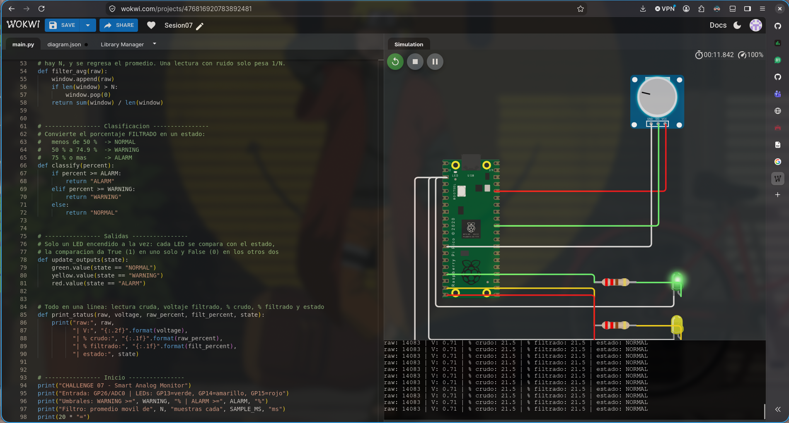
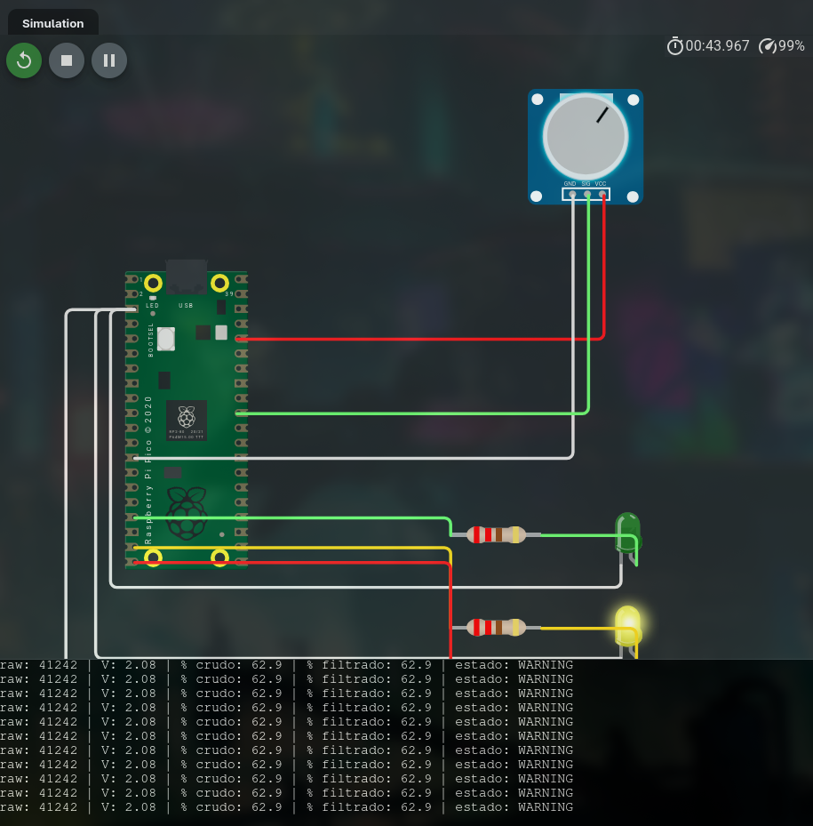
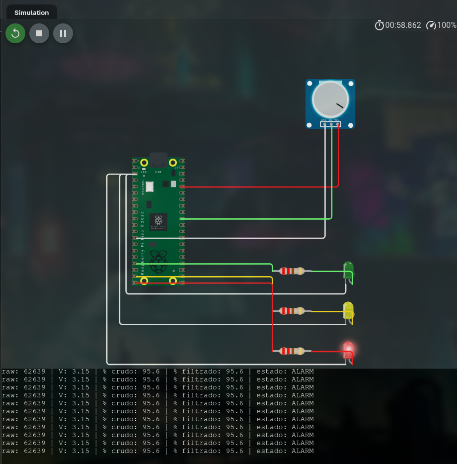
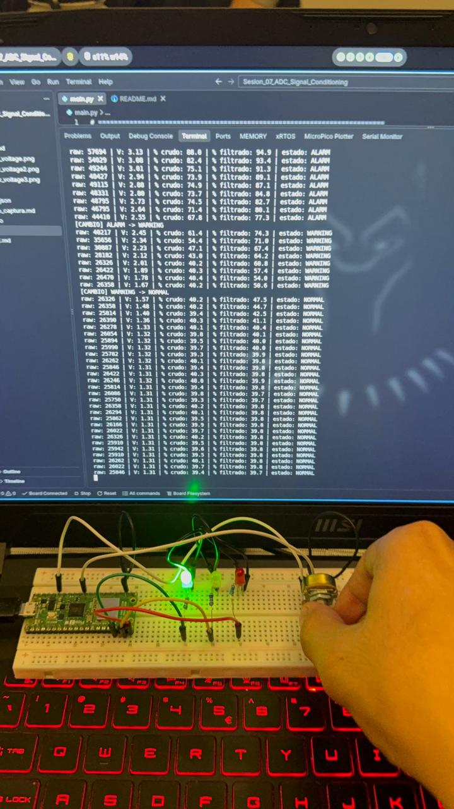
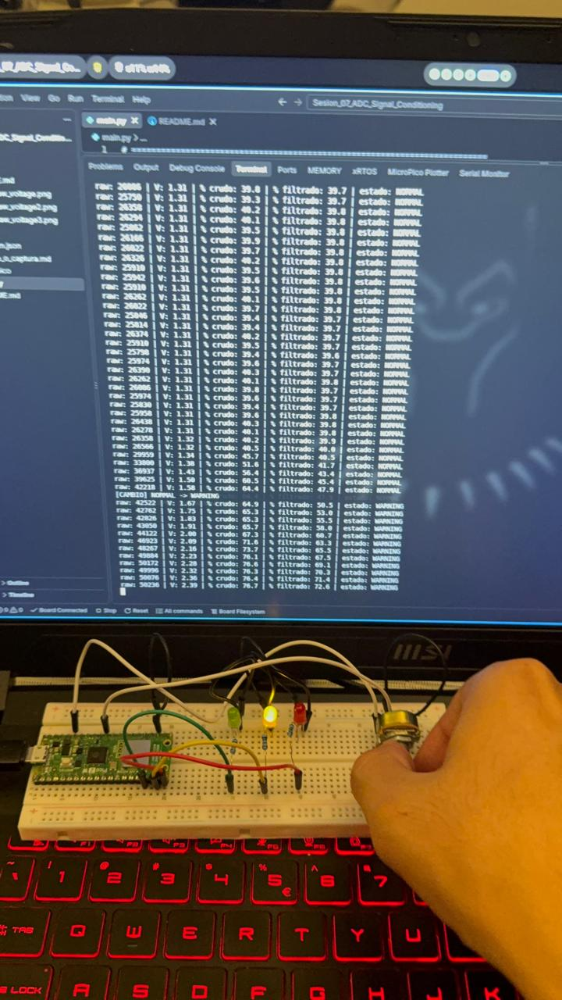
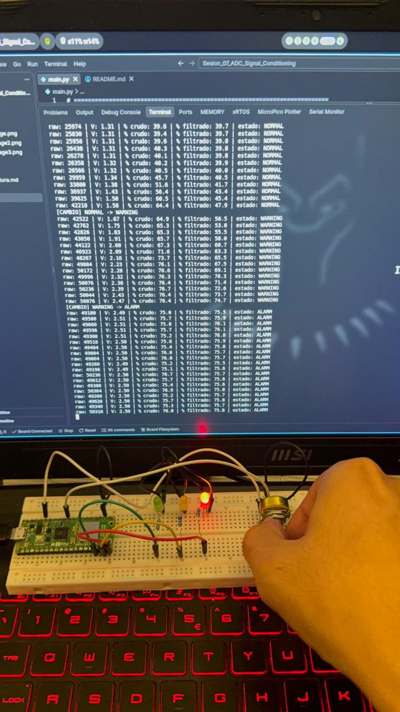

# Sesión 07 - Conversión ADC: Smart Analog Monitor

_Trabajo individual: Axel García Arellano · 201251_

## 1. Objetivo

Construir un **monitor analógico** con la Raspberry Pi Pico que:

1. Lee una señal analógica en **GP26 / ADC0** (un potenciómetro).
2. La convierte a **voltaje** y **porcentaje**.
3. La suaviza con un **filtro de promedio móvil**.
4. Con la señal ya filtrada decide si el sistema está en **NORMAL**, **WARNING** o **ALARM**.
5. Enciende el LED **verde**, **amarillo** o **rojo** según el estado, y lo imprime todo por serial.

El potenciómetro hace el papel de un sensor ya acondicionado (luz, temperatura, presión, nivel…). Lo importante no es mover la perilla, sino la cadena completa:

```
medir → filtrar → convertir → clasificar → actuar
raw   → promedio → V y %   → estado     → LED + serial
```

Todo está en MicroPython. El mismo `main.py` sirve en Wokwi (Pico RP2040) y en mi placa física (Pico 2 W).

## 2. Qué es un ADC y qué significa `read_u16()`

Un pin digital solo me dice **"¿está en 0 o en 1?"**. Un **ADC** (convertidor analógico-digital) me dice **"¿cuánto?"**. Hace dos cosas:

- **Muestreo**: toma una "foto" del voltaje del pin en un instante.
- **Cuantización**: convierte ese voltaje en un número entero.

En la Pico solo tres pines tienen ADC: **GP26 = ADC0**, GP27 = ADC1 y GP28 = ADC2. Yo uso GP26.

```python
from machine import Pin, ADC
sensor = ADC(Pin(26))      # lector analogico en GP26
raw = sensor.read_u16()    # numero de 0 a 65535
```

**¿Por qué llega a 65535?** `read_u16()` significa "léelo como entero sin signo (**u**nsigned) de **16** bits". Con 16 bits el número más grande que cabe es 2¹⁶ − 1 = **65535**. Entonces:

- 0 V → 0
- 3.3 V → 65535

El ADC de la Pico es de 12 bits por dentro (0 a 4095), pero MicroPython escala la lectura a 16 bits para que el mismo código funcione en cualquier placa. Por eso los valores avanzan de 16 en 16 y no de uno en uno.

## 3. Circuito

| Componente | Pin del componente | Pin de la Pico |
|---|---|---|
| Potenciómetro 10 kΩ | extremo 1 | 3V3 |
| Potenciómetro 10 kΩ | extremo 2 | GND |
| Potenciómetro 10 kΩ | cursor (centro) | **GP26 / ADC0** |
| LED verde + resistencia 220 Ω | ánodo (pata larga) | GP13 |
| LED amarillo + resistencia 220 Ω | ánodo (pata larga) | GP14 |
| LED rojo + resistencia 220 Ω | ánodo (pata larga) | GP15 |
| Los tres LEDs | cátodo (pata corta) | GND |

```
         Raspberry Pi Pico
        ┌──────────────────┐
  3V3 ──┤ 3V3              │
        │                  │      ┌── extremo 1 ── 3V3
        │             GP26 ├──────┤  POT 10k (cursor)
        │                  │      └── extremo 2 ── GND
        │                  │
        │             GP13 ├── 220 Ω ──►|── GND   LED verde
        │             GP14 ├── 220 Ω ──►|── GND   LED amarillo
        │             GP15 ├── 220 Ω ──►|── GND   LED rojo
  GND ──┤ GND              │
        └──────────────────┘
```

El potenciómetro es un **divisor de voltaje**: el cursor entrega cualquier voltaje entre 0 V y 3.3 V según la posición de la perilla.

> ⚠️ **Nunca más de 3.3 V en GP26.** Las entradas ADC de la Pico no toleran 5 V; se pueden dañar. Por eso los extremos del potenciómetro van al **3V3** de la Pico y no a VBUS ni VSYS. Si tengo duda, mido con el multímetro antes de conectar.

## 4. Fórmulas de conversión

Son **reglas de tres**. El ADC no sabe qué sensor tengo conectado; yo le doy significado al número.

```
voltaje    = raw × 3.3 / 65535
porcentaje = raw × 100 / 65535
```

| raw | Voltaje | Porcentaje |
|---|---|---|
| 0 | 0 × 3.3 / 65535 = **0.00 V** | 0 × 100 / 65535 = **0.0 %** |
| 32767 | 32767 × 3.3 / 65535 ≈ **1.65 V** | 32767 × 100 / 65535 ≈ **50.0 %** |
| 65535 | 65535 × 3.3 / 65535 = **3.30 V** | 65535 × 100 / 65535 = **100.0 %** |

En el código uso `max()` y `min()` para **limitar** el valor: `max(0, min(65535, raw))` garantiza que nunca salga un voltaje negativo ni mayor a 3.3 V.

## 5. Filtro de promedio móvil

### El problema

Una lectura real nunca está quieta. Aunque no toque la perilla, el ruido eléctrico, los cables y el propio ADC hacen que el valor "baile": 52.1 %, 51.8 %, 52.4 %, 53.0 %…

### La solución

El promedio móvil guarda las **últimas 10 lecturas** y saca su promedio. Cada vez que llega una nueva, sale la más vieja:

```
ventana: [51, 52, 52, 53, 52, 51, 52, 53, 52, 52]  → promedio = 52.0 %
llega 70 (ruido) → sale 51 → promedio = 53.9 %      (solo subió ~2 %)
```

Una lectura con ruido solo pesa **1/10** del resultado, así que casi no mueve la señal filtrada. Un cambio **real** y sostenido sí la mueve, porque poco a poco llena toda la ventana.

**El costo es el retraso**: muestreo cada 100 ms y la ventana es de 10, así que la señal filtrada tarda **~1 s** en alcanzar un cambio brusco de la perilla.

### ¿Por qué conviene filtrar antes de activar una alarma?

Porque la alarma debe reaccionar a lo que **realmente** pasa con la variable física, no a una lectura suelta. Si clasifico cada lectura cruda:

- Un solo pico de ruido que cruce el umbral enciende el rojo aunque todo esté bien → **falsa alarma**.
- Si la señal está cerca del límite, el ruido la hace cruzarlo hacia arriba y hacia abajo una y otra vez → el LED **parpadea** y el estado no sirve para decidir nada.
- Si la alarma moviera algo real (un relé, una bomba, un motor), esos cambios rápidos lo desgastarían.

Lo probé en la computadora: corrí `main.py` con un módulo `machine` simulado que daba 30 lecturas con ruido aleatorio de ±6 % alrededor del 50 %, con 5 secuencias diferentes. La lectura **cruda** cruzaba el umbral del 50 % **entre 9 y 19 veces** (14, 14, 9, 19 y 10). El estado del monitor, que usa la señal **filtrada**, cambió **0, 10, 3, 1 y 1 veces**: en 4 de las 5 pruebas el parpadeo casi desapareció.

La prueba que dio 10 cambios me enseñó un límite del filtro: si el valor **real** está justo en el umbral (50.0 %), el promedio también queda pegado a 50 % y todavía puede cruzarlo de ida y vuelta. Para eso se usa **histéresis**: un umbral para subir de estado (por ejemplo 50 %) y otro un poco más bajo para regresar (por ejemplo 47 %). No la dejé en `main.py` porque la práctica pide los rangos exactos <50 / 50–74 / ≥75, pero sería la siguiente mejora.

## 6. Umbrales elegidos

```python
WARNING = 50
ALARM = 75
```

| Estado | % filtrado | LED |
|---|---|---|
| NORMAL | menos de 50 % | Verde (GP13) |
| WARNING | 50 % a 74.9 % | Amarillo (GP14) |
| ALARM | 75 % o más | Rojo (GP15) |

Elegí **50 / 75** porque reparten el rango en tres zonas claras: la mitad baja es "todo bien", hay una banda de advertencia amplia (25 %) para darme tiempo de reaccionar, y la alarma solo se activa en el último cuarto. Como el potenciómetro simula un sensor genérico, no hay un límite físico que me obligue a moverlos.

### Comparación de configuraciones (DO 02)

| Configuración | Qué pasa | ¿Cuándo convendría? |
|---|---|---|
| **50 / 75** (elegida) | Tres zonas equilibradas; la alarma solo con valores altos | Sensor genérico o demostración, como esta práctica |
| **40 / 60** | Avisa antes y entra en alarma antes; más sensible, pero da más alarmas | Cuando llegar tarde es peligroso: temperatura de una batería, gas, sobrecalentamiento |
| **70 / 90** (propuesta) | Muy tolerante; solo avisa cerca del máximo | Una señal que normalmente trabaja alta, como el nivel de un tanque que debe estar casi lleno, o cuando una falsa alarma sale cara (detener una línea de producción) |

Un umbral es una **decisión de ingeniería**, no un número mágico: depende de qué es peor, una falsa alarma o una alarma tardía.

## 7. Explicación del código

### Configuración inicial

```python
sensor = ADC(Pin(26))                  # GP26 = ADC0
green = Pin(13, Pin.OUT, value=0)      # LED verde
yellow = Pin(14, Pin.OUT, value=0)     # LED amarillo
red = Pin(15, Pin.OUT, value=0)        # LED rojo

VREF = 3.3
ADC_MAX = 65535
WARNING = 50
ALARM = 75
N = 10
SAMPLE_MS = 100
window = []
```

Los LEDs se crean apagados (`value=0`). Todos los números que podría querer cambiar (umbrales, tamaño de la ventana, periodo de muestreo) están arriba como constantes, así no tengo que buscarlos dentro de la lógica.

### `read_raw()`

```python
def read_raw():
    return sensor.read_u16()
```

Solo lee el ADC. La separé en su propia función para que, si algún día cambio de sensor o de pin, solo tenga que tocar aquí.

### `to_voltage(raw)` y `to_percent(raw)`

```python
def to_voltage(raw):
    raw = max(0, min(ADC_MAX, raw))
    return raw * VREF / ADC_MAX

def to_percent(raw):
    raw = max(0, min(ADC_MAX, raw))
    return raw * 100 / ADC_MAX
```

Son las reglas de tres de la sección 4. Primero limitan `raw` entre 0 y 65535, y luego convierten.

### `filter_avg(raw)`

```python
def filter_avg(raw):
    window.append(raw)
    if len(window) > N:
        window.pop(0)
    return sum(window) / len(window)
```

1. `append(raw)` mete la lectura nueva al final de la lista.
2. Si ya hay más de 10, `pop(0)` saca la primera, que es la más vieja.
3. Regresa el promedio de lo que haya.

Al arrancar la lista tiene menos de 10 lecturas, y se promedia lo que haya. Por eso el programa da un valor útil desde la primera muestra.

### `classify(percent)`

```python
def classify(percent):
    if percent >= ALARM:
        return "ALARM"
    elif percent >= WARNING:
        return "WARNING"
    else:
        return "NORMAL"
```

Primero pregunto por el umbral **más alto**. Si empezara por `>= WARNING`, un 90 % entraría ahí y nunca llegaría a ALARM.

### `update_outputs(state)`

```python
def update_outputs(state):
    green.value(state == "NORMAL")
    yellow.value(state == "WARNING")
    red.value(state == "ALARM")
```

Cada comparación da `True` (1) o `False` (0). Como el estado es uno solo, solo una de las tres comparaciones es verdadera, y entonces **solo un LED queda encendido**. No hace falta apagar los otros a mano.

### `print_status(...)`

```python
def print_status(raw, voltage, raw_percent, filt_percent, state):
    print("raw:", raw,
          "| V:", "{:.2f}".format(voltage),
          "| % crudo:", "{:.1f}".format(raw_percent),
          "| % filtrado:", "{:.1f}".format(filt_percent),
          "| estado:", state)
```

Imprime todo en una línea. Pongo el **% crudo** junto al **% filtrado** para ver en el serial cómo el filtro suaviza la señal. El voltaje que imprime es el de la señal **filtrada**, porque esa es la que usa el sistema para decidir.

### Bucle principal

```python
while True:
    raw = read_raw()                       # 1) medir
    filtered = filter_avg(raw)             # 2) filtrar
    voltage = to_voltage(filtered)         # 3) convertir
    raw_percent = to_percent(raw)
    filt_percent = round(to_percent(filtered), 1)
    state = classify(filt_percent)         # 4) clasificar
    update_outputs(state)                  # 5) actuar
    ...
    print_status(raw, voltage, raw_percent, filt_percent, state)
    sleep_ms(SAMPLE_MS)
```

- **El estado sale de `filt_percent`, no de `raw`**: una lectura aislada nunca decide la alarma.
- El porcentaje filtrado se **redondea a 1 decimal antes de clasificar**. Sin esto, con la perilla justo a la mitad (`raw = 32767`) el porcentaje real es 49.9992 %. El serial mostraba `50.0` pero el estado salía NORMAL, y parecía un error. Ahora decido con el mismo número que se ve en pantalla.
- Cuando el estado cambia se imprime una línea `[CAMBIO] NORMAL -> WARNING`, para que en la captura se vea el momento exacto de cada transición.
- La recuperación (ALARM → NORMAL) no necesita código extra: `classify()` se calcula de nuevo en cada vuelta, así que al bajar la señal el estado baja solo.
- Todo está dentro de un `try/finally`: si detengo el programa con Ctrl-C, se apagan los tres LEDs.

No usé `gc.collect()` porque la lista del filtro nunca pasa de 10 elementos, así que la memoria no crece.

Ejemplo de salida (corrida con lecturas simuladas, pasando de 0 a la mitad, luego al máximo y de regreso a 0):

```text
CHALLENGE 07 - Smart Analog Monitor
Entrada: GP26/ADC0 | LEDs: GP13=verde, GP14=amarillo, GP15=rojo
Umbrales: WARNING >= 50 % | ALARM >= 75 %
Filtro: promedio movil de 10 muestras cada 100 ms
====================
[CAMBIO] INICIO -> NORMAL
raw: 0 | V: 0.00 | % crudo: 0.0 | % filtrado: 0.0 | estado: NORMAL
...
[CAMBIO] NORMAL -> WARNING
raw: 32767 | V: 1.65 | % crudo: 50.0 | % filtrado: 50.0 | estado: WARNING
...
[CAMBIO] WARNING -> ALARM
raw: 65535 | V: 2.47 | % crudo: 100.0 | % filtrado: 75.0 | estado: ALARM
...
[CAMBIO] ALARM -> WARNING
raw: 0 | V: 2.31 | % crudo: 0.0 | % filtrado: 70.0 | estado: WARNING
[CAMBIO] WARNING -> NORMAL
raw: 0 | V: 1.32 | % crudo: 0.0 | % filtrado: 40.0 | estado: NORMAL
```

Se ve el filtro trabajando: el % crudo salta a 100 de golpe, pero el % filtrado va subiendo por pasos.

## 8. Tabla de pruebas

| Prueba | Esperado | Observado | PASS/FAIL |
|---|---|---|---|
| ADC mínimo | raw cercano a 0 / 0 % | | |
| ADC medio | raw cercano a 32767 / 50 % | | |
| ADC máximo | raw cercano a 65535 / 100 % | | |
| Filtro | La señal filtrada cambia suavemente | **Físico:** al girar la perilla, el % crudo salta 45.7 → 51.6 → 56.4 → 60.5 → 64.4 y el % filtrado sube suave 40.5 → 41.7 → 43.4 → 45.4 → 47.9 | PASS |
| Normal | LED verde activo | **Wokwi:** raw 14083 · 0.71 V · 21.5 % → NORMAL, LED verde. **Físico:** raw ≈ 25 900 · 1.31 V · ≈ 39.8 % → NORMAL, LED verde | PASS |
| Warning | LED amarillo activo | **Wokwi:** raw 41242 · 2.08 V · 62.9 % → WARNING, LED amarillo. **Físico:** entra a WARNING en 50.5 % y llega a 72.6 % (2.39 V), LED amarillo | PASS |
| Alarm | LED rojo activo | **Wokwi:** raw 62639 · 3.15 V · 95.6 % → ALARM, LED rojo. **Físico:** entra a ALARM en 75.5 % (raw 49180 · 2.49 V) y se queda en ≈ 75.7 %, LED rojo | PASS |
| Recuperación | Vuelve de ALARM a NORMAL al bajar la señal | **Físico:** al bajar la perilla, el serial muestra `[CAMBIO] ALARM -> WARNING` (74.3 %) y `[CAMBIO] WARNING -> NORMAL` (47.5 %); termina en ≈ 39.8 % con el LED verde | PASS |

Los valores de **Wokwi** salen de las capturas de la sección 10 y los del **físico** del serial de VS Code (MicroPico) que se ve en las fotos del montaje con la Pico 2 W. En todas solo está encendido el LED que corresponde, y el voltaje y el porcentaje cumplen la regla de tres (por ejemplo, 41242 × 3.3 / 65535 = 2.08 V). Los valores físicos marcados con ≈ los leí de las fotos de la pantalla.

En la prueba de filtro se ve justo lo que buscaba: el crudo cambió casi 19 puntos en cinco lecturas y el filtrado solo 7, siguiendo la tendencia sin saltos. Por eso el cambio a WARNING ocurre hasta que el **promedio** pasa de 50 %, aunque el crudo ya había cruzado antes (51.6 %).

> En la placa física es normal que el mínimo no sea exactamente 0 ni el máximo exactamente 65535: el ADC real tiene un pequeño offset y ruido. Por eso la tabla dice "cercano a".

## 9. DO 01: mediciones

Muevo el potenciómetro a cinco posiciones y anoto los valores cuando la señal filtrada ya está estable:

| Posición | Raw | Voltaje | % |
|---|---|---|---|
| Mínima | | | |
| 25 % | | | |
| 50 % | | | |
| 75 % | | | |
| Máxima | | | |

## 10. Evidencia

### Simulación en Wokwi

- Proyecto principal (potenciómetro): https://wokwi.com/projects/476816920783892481
- Bonus con fotorresistencia: https://wokwi.com/projects/477353681322258433
- Cómo recrear la simulación: [`wokwi/enlace_o_captura.md`](./wokwi/enlace_o_captura.md) · circuito: [`wokwi/diagram.json`](./wokwi/diagram.json)

### Serial y LEDs en los tres estados

Cada captura muestra el serial (raw, voltaje, % crudo, % filtrado y estado) y el LED que se enciende:

| Estado | raw | Voltaje | % filtrado | LED | Captura |
|---|---|---|---|---|---|
| NORMAL | 14083 | 0.71 V | 21.5 % | Verde | [`serial_raw_voltage.png`](./evidence/serial_raw_voltage.png) |
| WARNING | 41242 | 2.08 V | 62.9 % | Amarillo | [`threshold_warning.png`](./evidence/threshold_warning.png) |
| ALARM | 62639 | 3.15 V | 95.6 % | Rojo | [`threshold_alarm.png`](./evidence/threshold_alarm.png) |

**NORMAL**: potenciómetro abajo, LED verde (se ve también el código en Wokwi):



**WARNING**: potenciómetro a media-alta posición, LED amarillo:



**ALARM**: potenciómetro casi al máximo, LED rojo:



### Montaje físico (Pico 2 W)

Probé el mismo `main.py` en mi placa física, una Raspberry Pi Pico 2 W en protoboard, con el potenciómetro en GP26 y los LEDs con 220 Ω en GP13/GP14/GP15. Lo corrí desde VS Code con MicroPico. En cada foto se ven el serial y el LED encendido:

| Foto | LED | Qué muestra el serial |
|---|---|---|
| [`hardware_photo.jpg`](./evidence/hardware_photo.jpg) | Verde | Recuperación: `ALARM -> WARNING -> NORMAL` al bajar la perilla |
| [`hardware_warning.jpg`](./evidence/hardware_warning.jpg) | Amarillo | El filtro suavizando la subida y `NORMAL -> WARNING` |
| [`hardware_alarm.jpg`](./evidence/hardware_alarm.jpg) | Rojo | `WARNING -> ALARM` y la señal estable en ≈ 75.7 % |

**NORMAL / recuperación**: LED verde:



**WARNING**: LED amarillo:



**ALARM**: LED rojo:



## 11. Exit ticket

**1. ¿Qué significa que el ADC convierta una señal analógica en un número?**
Que toma un voltaje que puede tener cualquier valor entre 0 y 3.3 V, lo mide en un instante (muestreo) y le asigna el entero más cercano de una escala fija (cuantización). Así el microcontrolador, que solo entiende números, puede trabajar con una magnitud continua.

**2. ¿Por qué `read_u16()` llega hasta 65535?**
Porque regresa un entero sin signo de 16 bits, y el mayor número que cabe en 16 bits es 2¹⁶ − 1 = 65535. El ADC de la Pico mide en 12 bits (0-4095), pero MicroPython escala el valor a 16 bits para que el código sea igual en todas las placas.

**3. ¿Cómo convertimos una lectura cruda a voltaje?**
Con una regla de tres: `voltaje = raw × 3.3 / 65535`. Por ejemplo, raw = 32767 da ≈ 1.65 V. Para porcentaje es igual, pero con 100: `raw × 100 / 65535`.

**4. ¿Por qué una lectura aislada puede provocar una falsa alarma?**
Porque toda señal real trae ruido. Una sola lectura puede salir más alta de lo que de verdad es y cruzar el umbral por un instante, aunque la variable esté en rango. Si el sistema decide con esa lectura suelta, enciende la alarma sin motivo. Por eso decido con el promedio de varias lecturas.

**5. ¿Qué diferencia hay entre medir, filtrar y clasificar?**
- **Medir**: obtener el dato crudo del sensor (`read_u16()` → raw).
- **Filtrar**: limpiar ese dato quitando el ruido (promedio móvil), sin cambiar lo que significa.
- **Clasificar**: convertir el dato limpio en una decisión (NORMAL / WARNING / ALARM) comparándolo con los umbrales.

Medir da un número, filtrar da un número confiable y clasificar da una acción.

## 12. Bonus: cambiar el potenciómetro por LDR o NTC

El algoritmo no depende del potenciómetro: cualquier sensor que entregue de 0 a 3.3 V en GP26 funciona sin tocar el código. Un LDR o un NTC cambian de **resistencia**, no de voltaje, así que necesitan un **divisor de voltaje** con una resistencia fija de 10 kΩ:

```
LDR                           NTC
3V3 ─── LDR ───┐              3V3 ─── NTC ───┐
               ├── GP26                      ├── GP26
GND ─── 10k ───┘              GND ─── 10k ───┘
```

- **LDR (fotorresistencia)**: más luz → menos resistencia → más voltaje en GP26 → más %. Con mis umbrales, ALARM significaría "demasiada luz". Si quisiera alarma por **oscuridad**, intercambio el LDR y la resistencia de 10 kΩ en el divisor, o uso `100 - porcentaje`.
- **NTC (termistor)**: más temperatura → menos resistencia → más voltaje → más %. ALARM significaría "temperatura alta". Para mostrar °C habría que agregar la ecuación del termistor (Beta o Steinhart-Hart), pero para la alarma basta con los porcentajes.

Como el divisor se alimenta del 3V3 de la Pico, GP26 sigue sin poder pasar de 3.3 V.

### Simulación del bonus con LDR en Wokwi

No tengo una LDR en físico, así que hice el bonus en Wokwi con el módulo `wokwi-photoresistor-sensor`. Todo está en [`wokwi/ldr_bonus/`](./wokwi/ldr_bonus/) y el proyecto es https://wokwi.com/projects/477353681322258433.

Ese módulo trae la LDR del lado de GND (al revés que el dibujo de arriba), así que **más luz = menos voltaje**. Por eso uso el porcentaje como **"% de oscuridad"**, con los mismos umbrales 50 / 75 (≈ 100 lux y ≈ 21 lux). El programa además calcula la luz en lux a partir del voltaje.

Resultados en Wokwi, moviendo el slider de iluminación:

| Slider de Wokwi | V en GP26 | Lux calculados | % oscuridad | Estado | LED |
|---|---|---|---|---|---|
| 2399 lux | 0.32 V | ~2407 lux | 9.7 % | NORMAL | Verde |
| 46 lux | 2.09 V | ~46 lux | 63.3 % | WARNING | Amarillo |
| 1 lux | 3.17 V | ~1.1 lux | 96.0 % | ALARM | Rojo |

El cálculo de lux coincidió con el valor del slider, y el mismo algoritmo del potenciómetro funcionó sin cambios en la lógica: solo cambió el sensor y lo que significa el porcentaje. Las capturas están en [`wokwi/ldr_bonus/README.md`](./wokwi/ldr_bonus/README.md).
