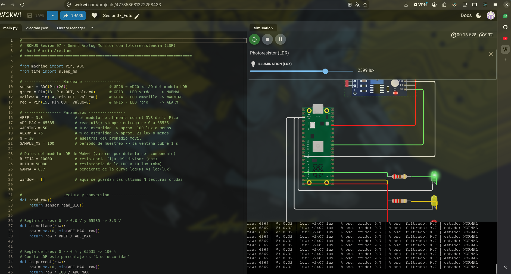
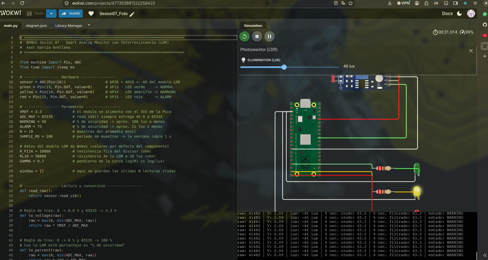
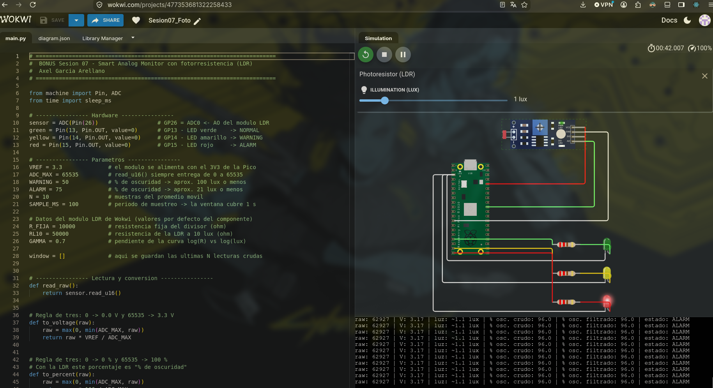

# Bonus: monitor con fotorresistencia (LDR) en Wokwi

Este es el bonus de la sesión: cambio el potenciómetro por una **fotorresistencia (LDR)**. No tengo la LDR en físico, así que solo lo hice en simulación. El algoritmo es el mismo de [`../../main.py`](../../main.py) (medir → filtrar → convertir → clasificar → actuar); lo único que cambia es el sensor y lo que significa el porcentaje.

- Proyecto en Wokwi: https://wokwi.com/projects/477353681322258433
- Circuito: [`diagram.json`](./diagram.json) · Código: [`main_ldr.py`](./main_ldr.py) (en Wokwi se pega como `main.py`)


## Circuito

| Módulo LDR | Pico |
|---|---|
| VCC | 3V3 |
| GND | GND |
| AO (salida analógica) | **GP26 / ADC0** |
| DO (salida digital) | sin conectar |

El módulo `wokwi-photoresistor-sensor` ya trae el divisor de voltaje adentro: la LDR va en serie con una resistencia de **10 kΩ** y AO sale del punto medio. Como lo alimento con el 3V3 de la Pico, AO nunca pasa de 3.3 V.

```
3V3 ── 10 kΩ ──┬── LDR ── GND
               │
               AO ──► GP26
```

## ¿Por qué "% de oscuridad"?

Con este módulo, **más luz → menos resistencia de la LDR → menos voltaje en AO**. Entonces el porcentaje del ADC sube cuando oscurece: lo uso como **% de oscuridad** y dejo los mismos umbrales que en `main.py` (50 / 75). Funciona como una lámpara automática que avisa cuando ya hace falta encender la luz:

| Estado | % oscuridad | Luz aproximada | LED |
|---|---|---|---|
| NORMAL | < 50 % | más de ~100 lux (oficina, día) | Verde |
| WARNING | 50 % a 74.9 % | ~21 a 100 lux (atardecer) | Amarillo |
| ALARM | ≥ 75 % | menos de ~21 lux (oscuro) | Rojo |

## Cálculo de lux

Además del porcentaje, el programa estima la luz en **lux** con dos fórmulas del módulo de Wokwi (RL10 = 50 kΩ, γ = 0.7):

```
1) Divisor:      R_ldr = 10 kΩ × V / (3.3 − V)
2) Curva LDR:    lux   = 10 × (50 kΩ / R_ldr) ^ (1 / 0.7)
```

Ejemplo: V = 1.65 V → R_ldr = 10 kΩ → lux = 10 × 5^1.43 ≈ **100 lux**. Por eso el umbral de 50 % cae justo en 100 lux.

El lux solo se imprime; el estado se sigue decidiendo con el % filtrado, igual que en el programa principal.


## Pruebas en Wokwi

| Prueba | Esperado | Observado | PASS/FAIL |
|---|---|---|---|
| Mucha luz (≥ 1000 lux) | LED verde, % oscuridad bajo | Slider 2399 lux → 0.32 V · ~2407 lux · 9.7 % → NORMAL, LED verde | PASS |
| Atardecer (~50 lux) | LED amarillo | Slider 46 lux → 2.09 V · ~46 lux · 63.3 % → WARNING, LED amarillo | PASS |
| Oscuro (≤ 10 lux) | LED rojo | Slider 1 lux → 3.17 V · ~1.1 lux · 96.0 % → ALARM, LED rojo | PASS |
| Filtro | Al mover el slider, el % filtrado cambia suavemente | | |
| Recuperación | Al subir la luz vuelve de ALARM a NORMAL | | |

El cálculo de lux coincidió con el slider de Wokwi: 2399 → ~2407 lux y 46 → ~46 lux. En 1 lux sale ~1.1: con tan poca luz el voltaje está casi en 3.3 V, la curva de la LDR es muy empinada y una diferencia mínima de voltaje mueve bastante el resultado. Además, el slider muestra el valor redondeado.

## Capturas

**Mucha luz (2399 lux): NORMAL, LED verde**



**Atardecer (46 lux): WARNING, LED amarillo**



**Oscuro (1 lux): ALARM, LED rojo**


