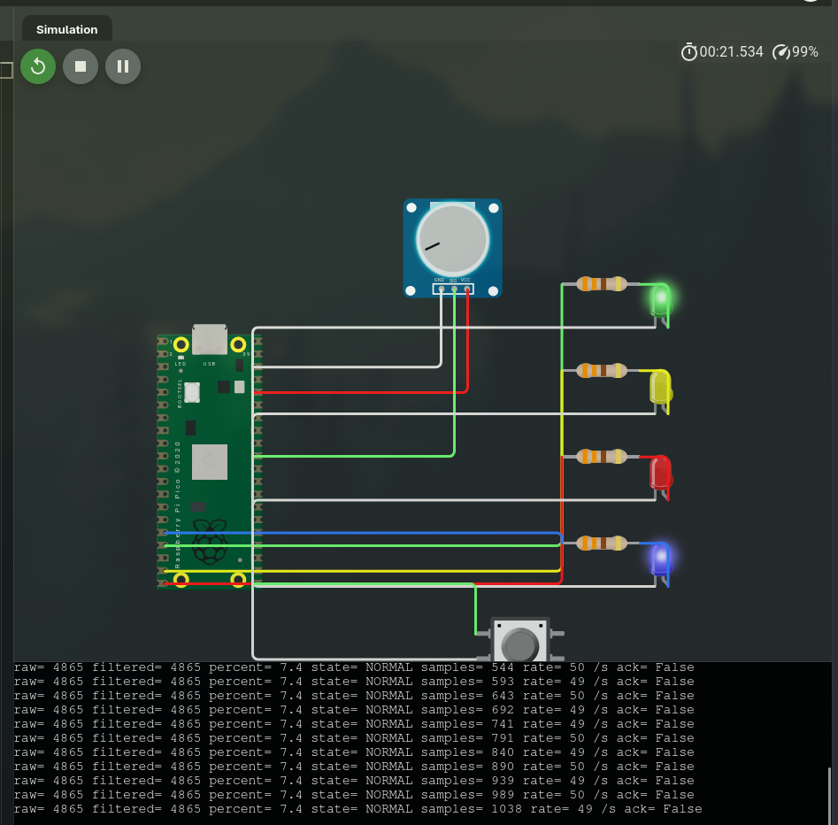
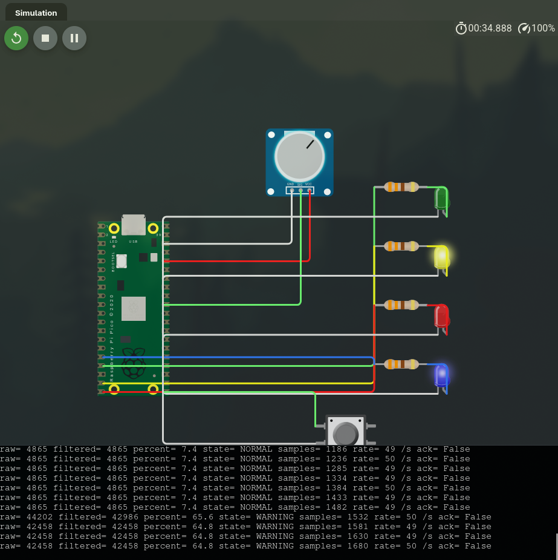
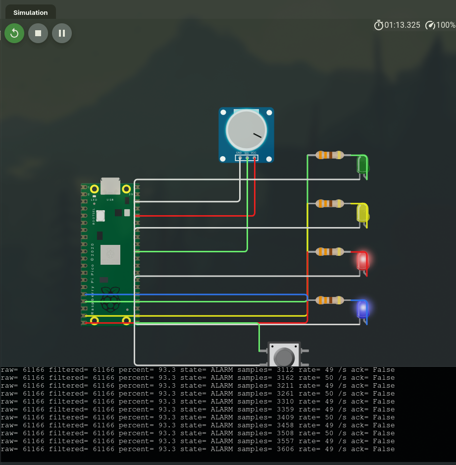
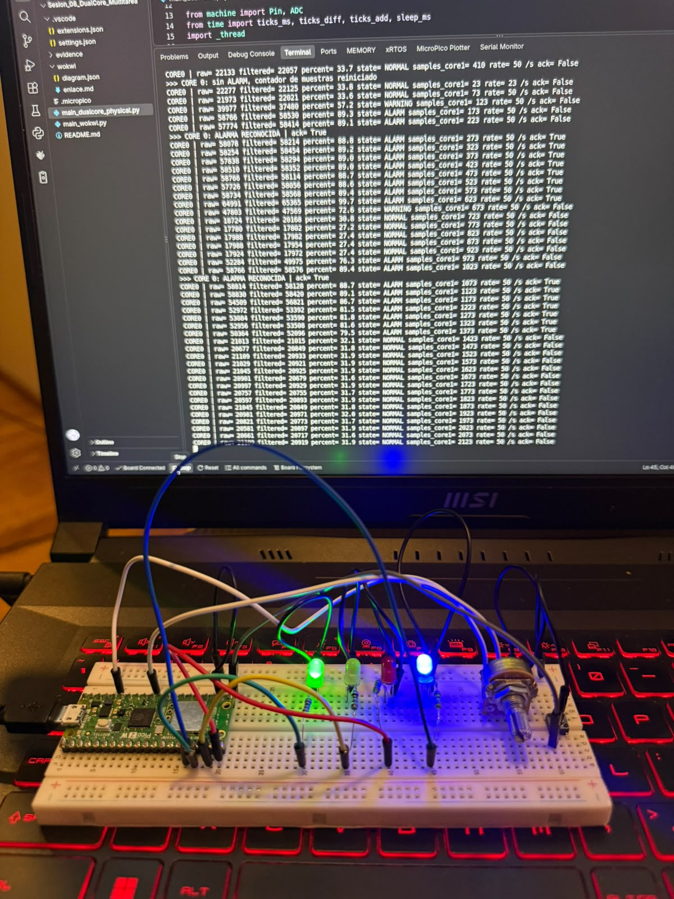
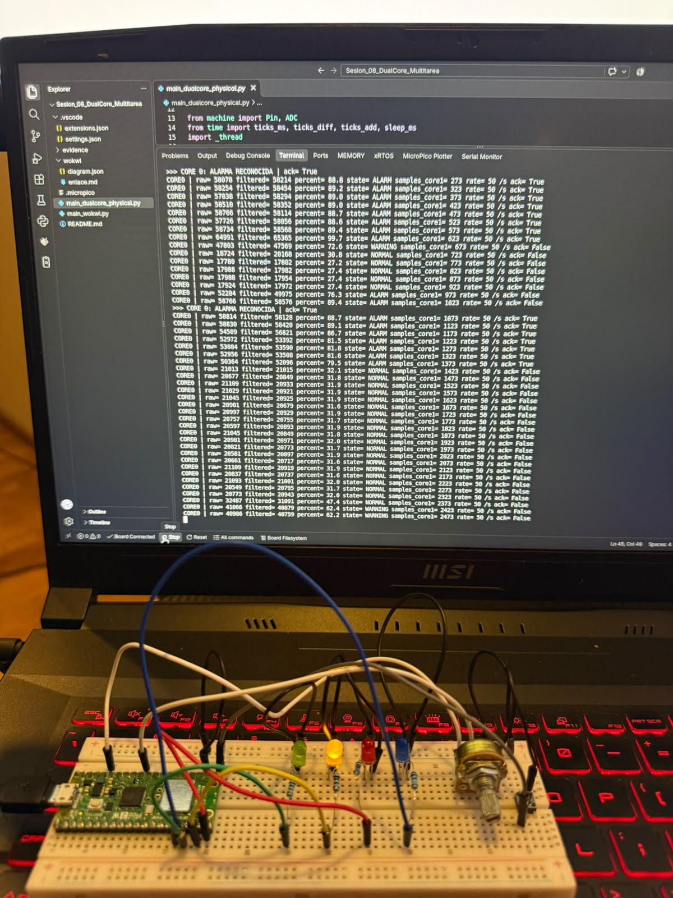
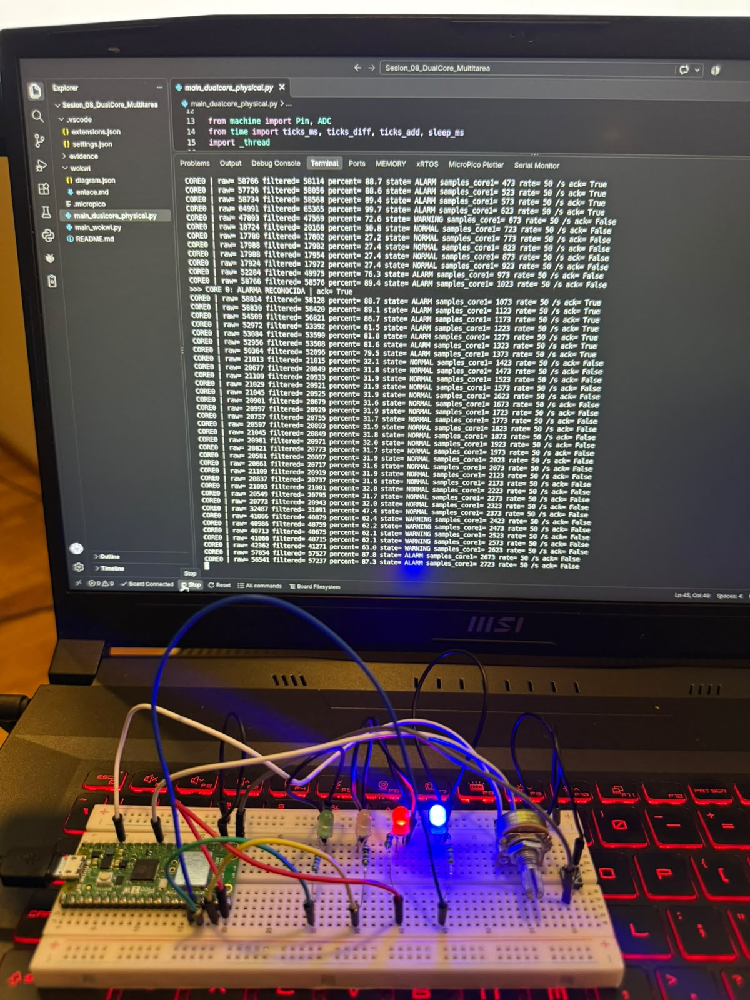
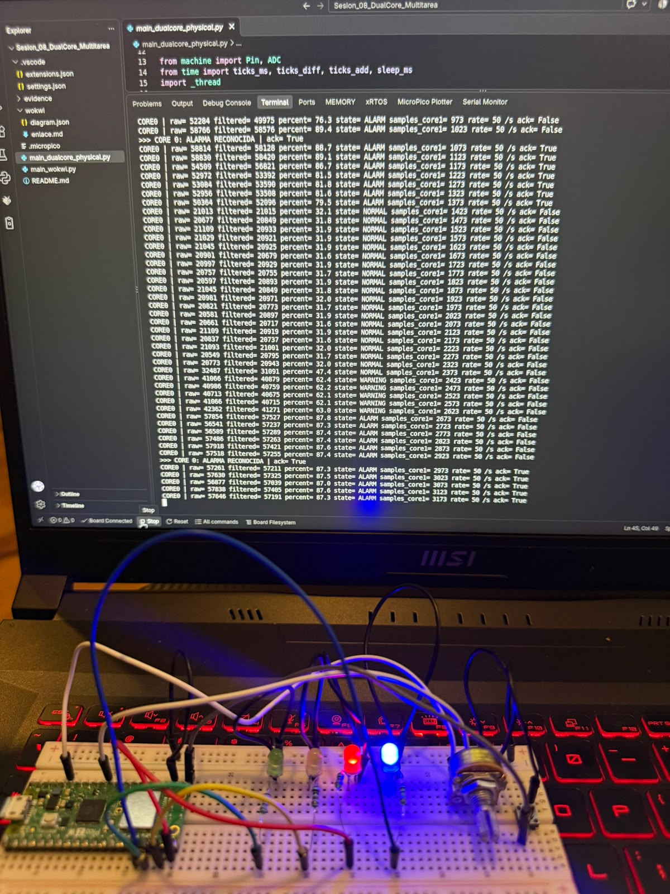

# Sesión 08 - Procesamiento Multihilo / Dual-Core

**Materia:** Laboratorio de Elementos Programables
**Sesión:** 08 - Multitarea cooperativa en Wokwi y dual-core real con `_thread` en la Pico

_Trabajo individual: Axel García Arellano · 201251_

## Objetivo

Construir un sistema en el que una tarea monitorea un sensor crítico (potenciómetro en GP26) de forma continua, mientras otras tareas actualizan LEDs, botón y serial sin bloquearse entre sí.

Se hicieron dos versiones con los mismos pines, umbrales, filtro y formato de serial, para comparar la simulación contra la placa real:

| Archivo | Dónde corre | Cómo reparte el trabajo |
|---|---|---|
| [`main_wokwi.py`](./main_wokwi.py) | Wokwi (Pico RP2040 simulada) | Un solo núcleo; cada tarea revisa con `ticks_ms()` si ya le toca |
| [`main_dualcore_physical.py`](./main_dualcore_physical.py) | Pico 2 W física, desde VS Code con MicroPico | Core 1 lee el sensor, Core 0 hace lo demás (`_thread` + `lock`) |

## 1. Qué es multitarea

Un microcontrolador ejecuta una instrucción a la vez. Si el loop tiene un `sleep(1)`, durante ese segundo no se lee el sensor, no se revisa el botón y no se actualiza ninguna salida. Ese es el problema que muestra `00_bloqueo.py`: el botón responde tarde porque el programa está detenido esperando.

Multitarea es organizar el programa para que varias tareas avancen al mismo tiempo sin que una detenga a las otras. En esta sesión se hizo de dos formas:

- **Cooperativa (Wokwi):** un solo núcleo, pero cada tarea es una función corta. El loop da vueltas cada ~2 ms y revisa si ya pasó el periodo de cada tarea (20 ms para el sensor, 200 ms para el heartbeat, etc.). Como ninguna tarea se queda dormida, todas se atienden a tiempo.
- **Dual-core real (Pico física):** el RP2350 de la Pico 2 W tiene dos núcleos. Con `_thread` la lectura del sensor se manda al Core 1 y el Core 0 se encarga de los procesos secundarios. Aunque el Core 0 tarde imprimiendo en el serial, el Core 1 sigue midiendo.

En resumen, un núcleo se dedica a monitorear el sensor crítico y el otro actualiza los procesos secundarios, sin que uno bloquee al otro.

| Tarea | Periodo | Wokwi | Pico física |
|---|---|---|---|
| Sensor: ADC + filtro + estado + contador | 20 ms (50 Hz) | loop único | **Core 1** |
| Botón: ACK / reset | 50 ms | loop único | Core 0 |
| LEDs de estado + heartbeat | 200 ms | loop único | Core 0 |
| Serial | 1000 ms | loop único | Core 0 |

El único `sleep` en los loops es `sleep_ms(2)` (`IDLE_MS`), que solo evita que el núcleo esté al 100 % sin necesidad.

## 2. Qué simula Wokwi

Proyecto: https://wokwi.com/projects/477448665161423873

El circuito está en [`wokwi/diagram.json`](./wokwi/diagram.json) y los pasos para recrearlo en [`wokwi/enlace.md`](./wokwi/enlace.md).

| Componente | Pin de la Pico | Pata física | Función |
|---|---|---|---|
| Potenciómetro (extremos a 3V3 y GND) | **GP26 / ADC0** | 31 | Sensor crítico |
| LED verde + resistencia | GP13 | 17 | NORMAL |
| LED amarillo + resistencia | GP14 | 19 | WARNING |
| LED rojo + resistencia | GP15 | 20 | ALARM (parpadea sin ACK, fijo con ACK) |
| LED azul + resistencia | GP12 | 16 | Heartbeat |
| Botón a GND (`PULL_UP` interno) | GP16 | 21 | ACK de alarma / reset del contador |

En Wokwi las resistencias son de 330 Ω.

Comportamiento en la simulación:

- El LED azul cambia cada 200 ms y no se detiene al mover el potenciómetro ni al presionar el botón.
- Al girar el potenciómetro, el LED de estado cambia casi de inmediato.
- El serial imprime una línea por segundo con `raw`, `filtered`, `percent`, `state`, `samples`, `rate` (muestras del último segundo) y `ack`.
- En ALARM el LED rojo parpadea; al presionar el botón queda fijo (`ack= True`). Fuera de ALARM, el botón reinicia el contador.

En Wokwi `rate` sale entre 49 y 50 /s. El siguiente turno del sensor se calcula desde el momento en que se atendió la tarea, y el loop revisa cada ~2 ms, así que el periodo real queda un poco arriba de 20 ms.

Wokwi no prueba el dual-core porque todo corre en un solo núcleo. Sirve para validar la lógica y los periodos de las tareas antes de pasar a la placa.

| NORMAL (verde) | WARNING (amarillo) |
|---|---|
|  |  |
| `percent= 7.4 state= NORMAL` | `percent= 64.8 state= WARNING` |

| ALARM sin ACK (rojo parpadea) | ALARM reconocida (rojo fijo) |
|---|---|
|  |  |
| `percent= 93.3 state= ALARM ack= False` | `>>> ALARMA RECONOCIDA \| ack= True` |

## 3. Qué prueba la Pico física

[`main_dualcore_physical.py`](./main_dualcore_physical.py) usa el mismo circuito que Wokwi, armado en protoboard con la Pico 2 W.

`_thread.start_new_thread(sensor_core, ())` lanza la lectura del sensor en el Core 1. Cada 20 ms lee el ADC, aplica el promedio móvil, calcula el porcentaje y el estado, y suma una muestra. El Core 0 atiende el botón (50 ms), los LEDs y el heartbeat (200 ms) y el serial (1000 ms).

**Uso del `lock`:** los dos núcleos comparten el diccionario `shared` (`raw`, `filtered`, `percent`, `state`, `samples`, `ack`, `running`, `error`). Si el Core 1 escribe mientras el Core 0 lee, el Core 0 podría obtener datos mezclados, por ejemplo un `raw` nuevo con un `state` viejo. Por eso:

- el Core 1 escribe todos los datos juntos dentro de `with lock:`;
- el Core 0 los lee con `read_shared()`, que copia todo de una vez con el lock tomado;
- el botón también toma el lock para revisar el estado y cambiar `ack` o `samples` en un solo paso;
- la lectura del ADC y los cálculos se hacen fuera del lock, para retenerlo el menor tiempo posible.

Al detener el programa con Stop, el `finally` pone `running = False` y el Core 1 sale de su loop, así que el siguiente Run no falla.

### Resultados en la placa

`rate=` se mantuvo en **50 /s** todo el tiempo y `samples_core1` aumentó 50 por línea, aun con el Core 0 imprimiendo y con el botón presionado. El heartbeat no se detuvo en ningún momento.

A diferencia de Wokwi, el ADC real tiene ruido. Con el potenciómetro fijo en NORMAL, `raw` varió entre 20549 y 21109 (≈ 560 cuentas) y `filtered` entre 20679 y 21015 (≈ 336 cuentas); el porcentaje filtrado se mantuvo entre 31.6 y 32.0 %.

| NORMAL (verde) | WARNING (amarillo) |
|---|---|
|  |  |
| `percent= 31.9 state= NORMAL`. En el serial también aparece el reset del contador (`samples_core1= 23`) | `percent= 62.2 state= WARNING` |

| ALARM sin ACK (rojo) | ALARM reconocida (rojo fijo) |
|---|---|
|  |  |
| `percent= 87.3 state= ALARM ack= False` | `>>> CORE 0: ALARMA RECONOCIDA` y después `ack= True` |

## 4. Cómo se usan los umbrales

Los umbrales están como constantes al inicio de los dos archivos y se comparan con el porcentaje de la señal **filtrada**, no con la lectura cruda:

```python
ADC_MAX = 65535         # read_u16() entrega de 0 a 65535
WARNING_PCT = 50        # 50 % a 74.9 % -> WARNING
ALARM_PCT = 75          # 75 % o mas    -> ALARM
```

```
percent = filtered × 100 / 65535
```

| Estado | Condición | Lectura filtrada | Voltaje en GP26 | LED | Significado |
|---|---|---|---|---|---|
| NORMAL | menos de 50 % | 0 – 32767 | 0 – 1.65 V | Verde | Variable en rango |
| WARNING | 50 % a 74.9 % | 32768 – 49151 | 1.65 – 2.47 V | Amarillo | Se acerca al límite |
| ALARM | 75 % o más | 49152 – 65535 | 2.47 – 3.3 V | Rojo | Condición crítica que debe reconocerse |

El botón detecta solo el cambio de 1 a 0, así que mantenerlo presionado cuenta como una sola pulsación:

- **En ALARM:** `ack = True`. El rojo deja de parpadear y queda fijo, pero el estado sigue en ALARM mientras la señal esté arriba de 75 %.
- **Fuera de ALARM:** reinicia el contador de muestras (`samples = 0`).
- **Al salir de ALARM:** el ACK se borra automáticamente. Si la señal vuelve a subir, el rojo parpadea otra vez.

## 5. Qué hace el filtro

Promedio móvil de **8 muestras** (`FILTER_SIZE = 8`). Con una muestra cada 20 ms, la ventana cubre 8 × 20 ms = **160 ms**.

```python
def moving_average(window, raw):
    window.append(raw)
    if len(window) > FILTER_SIZE:
        window.pop(0)
    return sum(window) // len(window)
```

Cada lectura nueva entra a la ventana, la más vieja sale y se regresa el promedio. El ruido del ADC es aleatorio (unas lecturas salen arriba y otras abajo del valor real), así que al promediar 8 lecturas esas variaciones se compensan. Un pico aislado solo pesa 1/8 del resultado y no alcanza para cruzar un umbral y generar una falsa alarma.

La desventaja es un retraso de ~160 ms ante un cambio brusco del potenciómetro, que en la práctica no se percibe.

En la placa el rango de variación de `filtered` fue aproximadamente 40 % menor que el de `raw` (336 contra 560 cuentas). En Wokwi no se aprecia porque el potenciómetro simulado no tiene ruido: con la perilla quieta, `raw` y `filtered` son iguales.

En la versión física el filtro (`window`) existe solo dentro del Core 1, así que no necesita lock.

## 6. Resultados de la tabla de pruebas

☑ = probado y observado · ☐ pendiente = aún no probado en ese entorno.

| Prueba | Qué se espera | Cómo se probó | Resultado (Wokwi) | Resultado (Pico física) | Evidencia |
|---|---|---|---|---|---|
| Pot bajo → NORMAL | menos de 50 %, `state= NORMAL`, solo verde | Potenciómetro al mínimo, lectura del serial | ☑ 7.4 %, NORMAL, verde | ☑ 31.9 %, NORMAL, verde | [`wokwi_normal.png`](wokwi/wokwi_normal.png), [`hardware_normal.jpg`](evidence/hardware_normal.jpg) |
| Pot medio → WARNING | 50 a 74.9 %, `state= WARNING`, solo amarillo | Potenciómetro a la mitad | ☑ 64.8 %, WARNING, amarillo | ☑ 62.2 %, WARNING, amarillo | [`wokwi_warning.png`](wokwi/wokwi_warning.png), [`hardware_warning.jpg`](evidence/hardware_warning.jpg) |
| Pot alto → ALARM | 75 % o más, `state= ALARM`, rojo parpadea | Potenciómetro al máximo | ☑ 93.3 %, ALARM, rojo parpadea con `ack= False` | ☑ 87.3 %, ALARM, rojo con `ack= False` | [`wokwi_alarm.png`](wokwi/wokwi_alarm.png), [`hardware_alarm.jpg`](evidence/hardware_alarm.jpg) |
| Heartbeat → no se congela | El azul cambia cada 200 ms sin detenerse | Observación del LED azul al mover el potenciómetro y presionar el botón | ☑ cambia de estado entre capturas | ☑ no se detuvo | [`wokwi_alarm.png`](wokwi/wokwi_alarm.png) / [`wokwi_alarm_ack.png`](wokwi/wokwi_alarm_ack.png), fotos de `evidence/` |
| Serial → actualiza cada 1 s | Una línea por segundo con `rate=` ≈ 50 /s | Incremento de `samples` entre líneas | ☑ +49/50 muestras por línea, `rate=` 49–50 /s | ☑ +50 muestras por línea, `rate= 50 /s` | Serial en todas las capturas |
| Filtro → reduce ruido | Con el pot fijo, `filtered` varía menos que `raw` | Potenciómetro fijo en NORMAL, comparación de columnas | No aplica: el pot simulado no tiene ruido (`raw` = `filtered`) | ☑ `raw` ≈ 560 cuentas de rango, `filtered` ≈ 336 | [`hardware_normal.jpg`](evidence/hardware_normal.jpg) |
| Botón → reset/ack | En ALARM `ack= True` y rojo fijo; fuera de ALARM `samples` vuelve a 0; al salir de ALARM `ack= False` | Botón en NORMAL y en ALARM, luego bajar el potenciómetro | ☑ ACK con rojo fijo | ☑ reset (`samples_core1= 23`), ACK y borrado automático al bajar a 72.6 % | [`wokwi_alarm_ack.png`](wokwi/wokwi_alarm_ack.png), [`hardware_normal.jpg`](evidence/hardware_normal.jpg), [`hardware_alarm_ack.jpg`](evidence/hardware_alarm_ack.jpg) |
| Físico → `_thread` | El Core 1 mantiene ≈ 50 muestras/s mientras el Core 0 atiende UI, botón y serial | `main_dualcore_physical.py` en la Pico 2 W | No aplica (Wokwi es un solo núcleo) | ☑ `rate= 50 /s` constante (después de corregir el error de la sección 7) | Serial en las fotos de `evidence/` |

## 7. Errores que tuve

### El Core 1 se moría con `NameError: name 'to_percent' isn't defined`

La primera vez que corrí `main_dualcore_physical.py` en la Pico funcionaba a medias: el LED azul parpadeaba y el botón reiniciaba el contador, pero ningún LED de estado se prendía al mover la perilla. En el serial salía esto:

```
Core 1: adquisicion del ADC iniciada
Core 0: boton, LEDs, heartbeat y serial
Unhandled exception in thread started by <function sensor_core at 0x200130d0>
Traceback (most recent call last):
  File "<stdin>", line 105, in sensor_core
NameError: name 'to_percent' isn't defined
CORE0 | raw= 0 filtered= 0 percent= 0.0 state= INIT samples_core1= 0 rate= 0 /s ack= False
CORE0 | raw= 0 filtered= 0 percent= 0.0 state= INIT samples_core1= 0 rate= 0 /s ack= False
```

El hilo del Core 1 se murió en la primera muestra, y el Core 0 siguió vivo pero sin datos. El estado se quedó en `INIT` y los LEDs de estado solo prenden con NORMAL, WARNING o ALARM; por eso solo funcionaba lo que hace el Core 0 (heartbeat y botón).

Lo raro es que `to_percent` sí estaba definida, y antes de lanzar el hilo. El problema es que el RP2350 corre los dos núcleos **sin GIL** (el "candado general" de MicroPython que en otros puertos evita que dos hilos toquen lo mismo a la vez). Justo después de `start_new_thread`, el Core 0 creaba variables globales nuevas (`now`, `next_button`, `next_ui`, `next_log`). Eso reorganizaba el diccionario de globales justo cuando el Core 1 estaba buscando `to_percent` ahí, y no la encontró. Por eso `moving_average`, una línea antes, sí funcionó: depende de en qué momento exacto chocan los dos núcleos.

Lo corregí así:

1. Metí el loop del Core 0 en una función `main()`. Así `now` y los `next_*` son variables locales, y una vez lanzado el hilo ya no se crea ninguna global nueva.
2. Envolví el loop del Core 1 en un `try/except`. Si vuelve a fallar, guarda el error en `shared["error"]` (con el lock) y el serial imprime `SENSOR_CORE ERROR | Core 1 detenido: ...` cada segundo en lugar de quedarse callado en `INIT`.

Después de eso el Core 1 corrió sin problemas a 50 muestras por segundo (las fotos de la sección 3 son con el código ya corregido).

Lo que me llevo: con dos núcleos también se comparten las variables globales del programa, aunque no estén en `shared`. Conviene tener todo creado **antes** de lanzar el hilo, y cuando un hilo falla hay que hacer que el error se vea en el serial.

## 8. Preguntas de análisis

**1. ¿Cuál es la diferencia entre multitarea cooperativa en Wokwi y dual-core real?**
En la cooperativa hay un solo núcleo y las tareas se turnan: cada una ejecuta algo corto y deja pasar a la siguiente. Si una tarda demasiado, las demás esperan. En dual-core hay dos núcleos trabajando en paralelo: el Core 1 lee el sensor mientras el Core 0 imprime o actualiza LEDs, así que un retraso en el Core 0 no afecta el muestreo. La cooperativa depende de que cada tarea sea rápida; el dual-core reparte la carga en hardware.

**2. ¿Por qué no usamos `sleep_ms(1000)` dentro de la tarea crítica del sensor?**
Porque durante ese segundo no se lee el sensor, y si la señal entra en ALARM el sistema lo detecta hasta 1 s después. En la versión de un solo núcleo además se congelan el botón, los LEDs y el heartbeat. Por eso cada tarea revisa con `ticks_ms()` si ya le toca, y el único `sleep` es de 2 ms.

**3. ¿Por qué una tarea puede ejecutarse cada 20 ms y el terminal cada 1000 ms?**
Porque cada tarea guarda su propio "siguiente turno" (`next_sensor`, `next_log`, etc.) y el loop compara cada uno con `ticks_ms()` de forma independiente. El sensor es la tarea crítica y necesita ir rápido; el serial es para lectura humana y una línea por segundo es suficiente.

**4. ¿Por qué se necesita `lock` cuando dos núcleos comparten datos?**
Porque ambos pueden acceder a `shared` al mismo tiempo. Sin lock, el Core 0 podría leer a mitad de una actualización y obtener datos que no corresponden entre sí, o las escrituras podrían pisarse (por ejemplo, el botón pone `ack = True` mientras el Core 1 lo borra). Con `with lock:` solo un núcleo a la vez entra a esa sección. El error de la sección 7 mostró que incluso las variables globales pueden causar problemas si se crean mientras el otro núcleo está corriendo.

**5. ¿Qué diferencia hay entre reconocer una alarma y eliminar la condición de alarma?**
Reconocerla (ACK) solo indica que el operador ya la vio: el rojo deja de parpadear y queda fijo, pero el estado sigue en ALARM mientras la señal esté arriba de 75 %. Eliminar la condición es que la variable regrese a un valor seguro (bajar el potenciómetro). Solo entonces cambia el estado y el ACK se borra automáticamente. En el serial de la Pico se ve: con `ack= True` el estado siguió en ALARM hasta bajar a 72.6 %, y ahí regresó a `ack= False`.

**6. ¿Qué evidencia demuestra que el sistema no se bloquea?**
- El heartbeat (LED azul) no se detuvo en ningún momento, aun moviendo el potenciómetro y presionando el botón.
- El serial se actualiza cada segundo con `rate=` constante (50 /s en la Pico, 49–50 /s en Wokwi), es decir, el sensor nunca dejó de leer.
- El mensaje `ALARMA RECONOCIDA` aparece entre dos líneas del serial, en cuanto se presiona el botón, sin esperar al siguiente ciclo de 1 s.

## Estructura de la carpeta

```text
Sesion_08_DualCore_Multitarea/
├── README.md
├── main_wokwi.py                 # versión cooperativa (un núcleo) para Wokwi
├── main_dualcore_physical.py     # versión con _thread para la Pico física
├── wokwi/
│   ├── diagram.json              # circuito de Wokwi
│   ├── enlace.md                 # enlace del proyecto y cómo recrearlo
│   ├── wokwi_normal.png          # Wokwi: NORMAL + serial
│   ├── wokwi_warning.png         # Wokwi: WARNING + serial
│   ├── wokwi_alarm.png           # Wokwi: ALARM sin ACK + serial
│   └── wokwi_alarm_ack.png       # Wokwi: ALARM con ACK + serial
└── evidence/
    ├── hardware_normal.jpg       # Pico física: NORMAL + serial
    ├── hardware_warning.jpg      # Pico física: WARNING + serial
    ├── hardware_alarm.jpg        # Pico física: ALARM sin ACK + serial
    └── hardware_alarm_ack.jpg    # Pico física: ALARM con ACK + serial
```

También se incluyen `.micropico` y `.vscode/`, la configuración de la extensión MicroPico, igual que en las sesiones anteriores.

## Cómo ejecutar

### `main_wokwi.py` en Wokwi

1. Abrir el proyecto: https://wokwi.com/projects/477448665161423873. Para recrearlo desde cero, crear uno nuevo de **Raspberry Pi Pico → MicroPython** y pegar [`wokwi/diagram.json`](./wokwi/diagram.json) en la pestaña `diagram.json`.
2. Pegar [`main_wokwi.py`](./main_wokwi.py) en la pestaña `main.py` y presionar ▶.
3. Clic en el potenciómetro para girarlo; el botón gris (o la tecla `A`) hace el ACK o el reset.

### `main_dualcore_physical.py` en la Pico (VS Code + MicroPico)

1. Armar el circuito de la sección 2 en la protoboard.
2. Conectar la Pico por USB (con MicroPython) y abrir **esta carpeta** en VS Code. El archivo `.micropico` hace que la extensión la reconozca como proyecto.
3. Esperar a que la barra inferior indique que la placa está conectada (o usar `MicroPico: Connect`).
4. Abrir `main_dualcore_physical.py` y presionar **Run** en la barra inferior. El serial aparece en la terminal de MicroPico.
5. Para detenerlo, **Stop** (o Ctrl-C). El programa apaga los LEDs y detiene el Core 1.
6. Si aparece `OSError: core1 in use`, hacer un reset suave (`MicroPico: Reset > Soft`, o Ctrl-D en la terminal) y volver a ejecutarlo.
