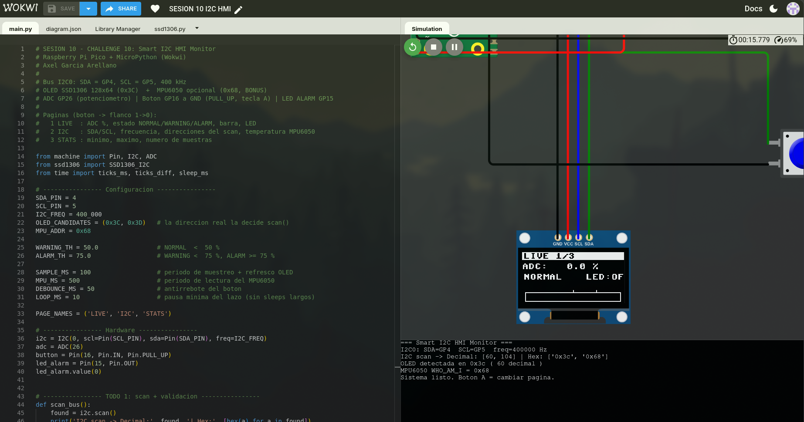
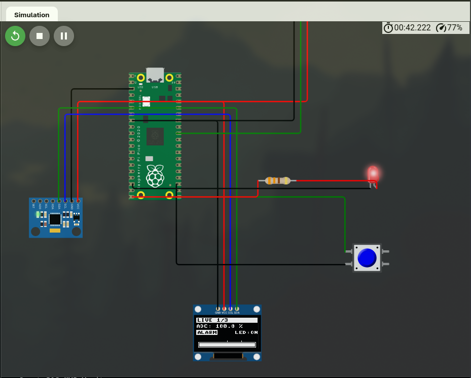
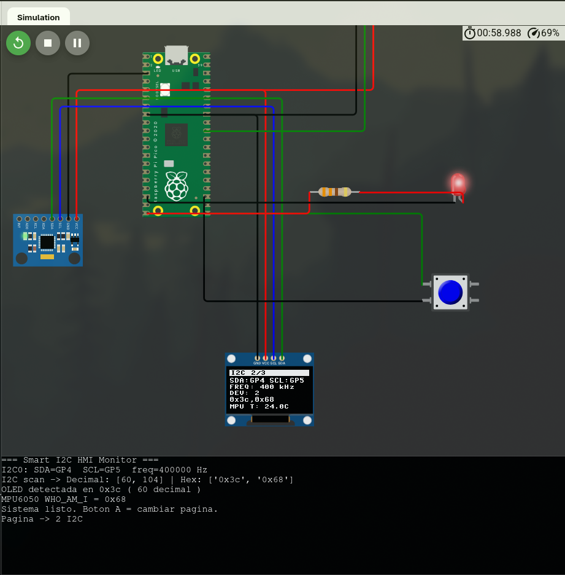
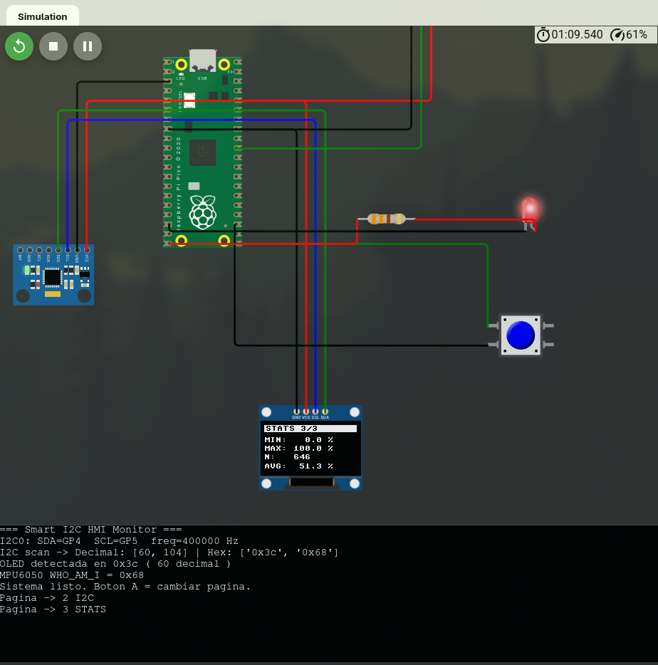
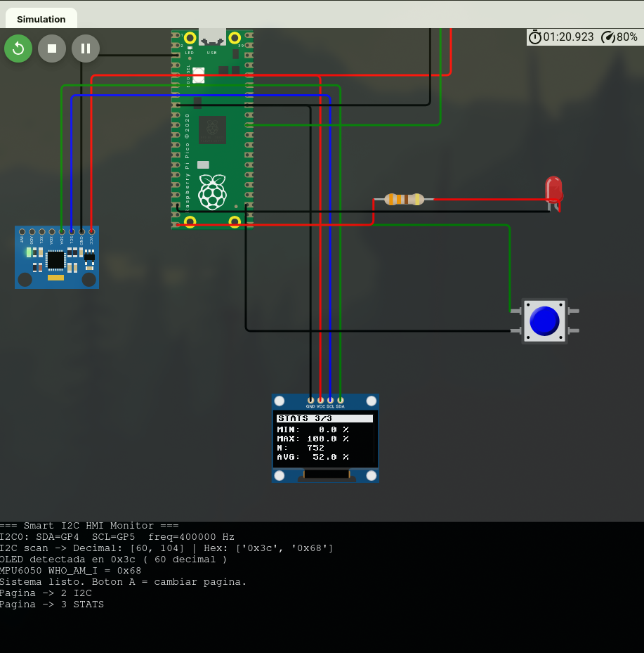
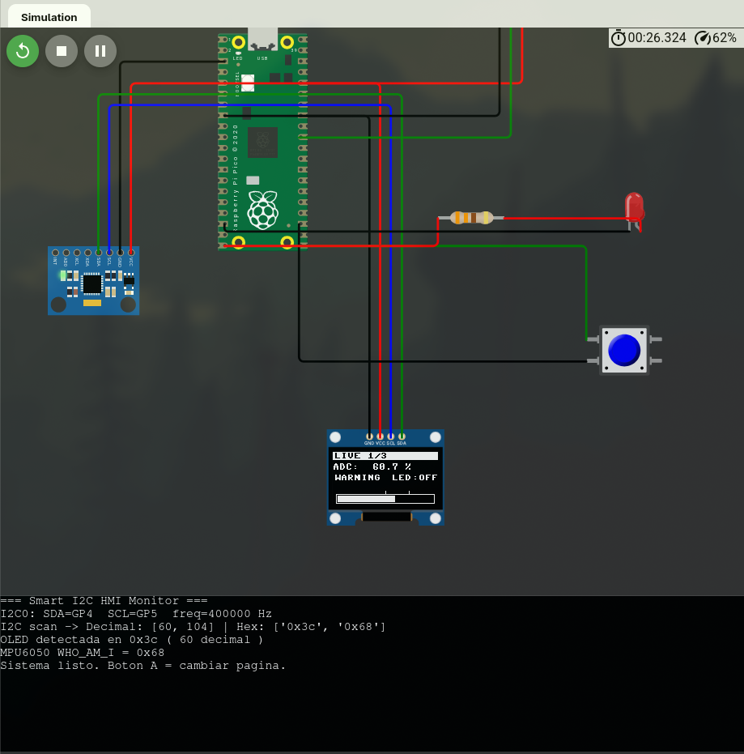
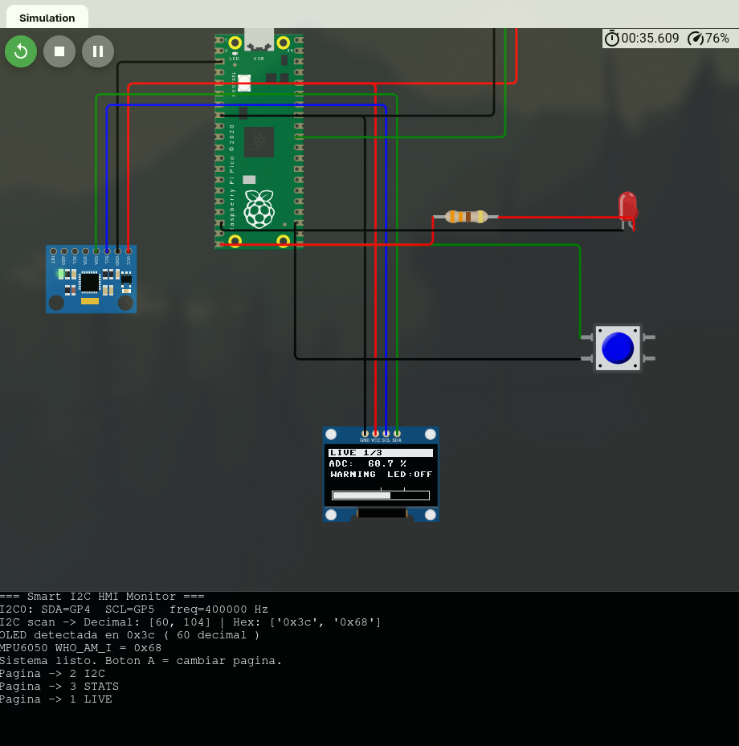
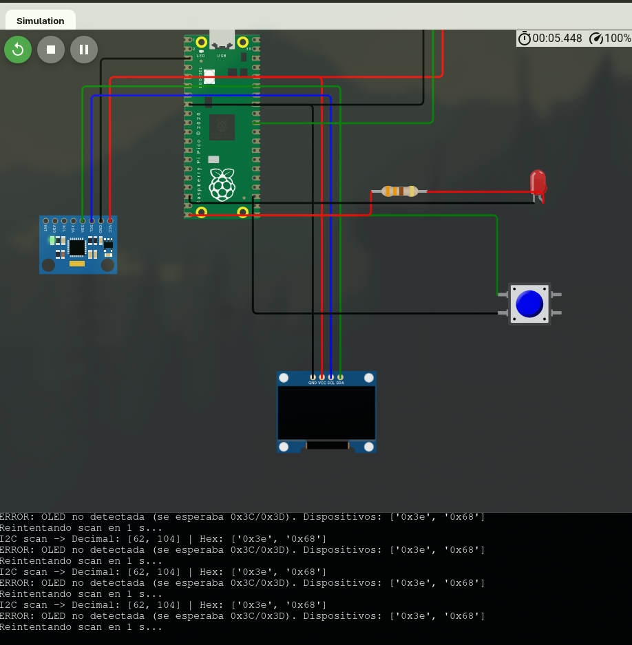

# Sesión 10 - Comunicación I2C + OLED HMI

**Materia:** Laboratorio de Elementos Programables
**Sesión:** 10 - CHALLENGE 10: Smart I2C HMI Monitor (simulado en Wokwi)

_Trabajo individual: Axel García Arellano · 201251_

## Objetivo

Construir una HMI embebida en una OLED SSD1306 conectada por I2C a la Raspberry Pi Pico. El sistema lee un potenciómetro (ADC), lo clasifica como NORMAL / WARNING / ALARM, enciende un LED de alarma y muestra todo en 3 páginas que se cambian con un botón. El bonus agrega un MPU6050 en el **mismo bus** para mostrar una lectura real de temperatura.

> La práctica se hizo **solo en Wokwi** porque no se consiguió la OLED física. Se usa el mismo pinout (GP4/GP5), así que el mismo `main.py` sirve en hardware.

| Archivo | Qué hace |
|---|---|
| [`main.py`](./main.py) | Smart I2C HMI Monitor: scan, validación de OLED, 3 páginas, LED ALARM, botón por flanco, bonus MPU6050 |
| [`ssd1306.py`](./ssd1306.py) | Driver del SSD1306 (sin cambios, viene del paquete de la clase) |
| [`diagram.json`](./diagram.json) | Circuito de Wokwi: Pico + OLED + potenciómetro + botón + LED + MPU6050 |
| [`evidence/`](./evidence) | Capturas de Wokwi |

## 1. Bus I2C

| Señal | Pin Pico | Función |
|---|---|---|
| SDA | GP4 (I2C0 SDA) | Datos, bidireccional |
| SCL | GP5 (I2C0 SCL) | Reloj, lo genera la Pico (controller) |
| VCC | 3V3 | Alimentación OLED y MPU6050 |
| GND | GND | Referencia común |

```python
i2c = I2C(0, scl=Pin(5), sda=Pin(4), freq=400_000)   # Fast-mode, 400 kHz
```

- **Frecuencia:** 400 kHz (Fast-mode). Es el reloj del bus, no los FPS de la pantalla.
- **Dirección OLED:** `0x3C` (60 decimal). El código también acepta `0x3D`, por si un módulo físico usa esa dirección; la que se usa es la que reporta `scan()`.

### Resultado de `i2c.scan()`

```
I2C scan -> Decimal: [60, 104] | Hex: ['0x3c', '0x68']
OLED detectada en 0x3c ( 60 decimal )
MPU6050 WHO_AM_I = 0x68
```

| Dispositivo | Decimal | Hex |
|---|---|---|
| OLED SSD1306 | 60 | 0x3C |
| MPU6050 (bonus) | 104 | 0x68 |

`60 = 3 × 16 + 12 = 0x3C`. Es el mismo número escrito en otra base.



### Conexiones (Wokwi)

```
Pico GP4  ──┬── OLED SDA
            └── MPU6050 SDA
Pico GP5  ──┬── OLED SCL
            └── MPU6050 SCL
Pico 3V3  ──── OLED VCC, MPU6050 VCC, Pot VCC
Pico GP26 ──── Potenciómetro SIG
Pico GP16 ──── Botón ──── GND        (PULL_UP interno, tecla A)
Pico GP15 ──── 330 Ω ──── LED ──── GND
```

## 2. HMI: las 3 páginas

El botón cambia de página cuando detecta el **flanco 1 → 0** (`page = (page + 1) % 3`). Además tiene un antirrebote de 50 ms con `ticks_ms()`, así que cada pulsación avanza exactamente una página.

| Página | Contenido |
|---|---|
| **1 · LIVE** | ADC en %, estado (ALARM en video inverso), `LED:ON/OFF` y barra 0–100 % con marcas en 50 % y 75 % |
| **2 · I2C** | SDA/SCL, frecuencia (400 kHz), número de dispositivos, direcciones detectadas y temperatura del MPU6050 |
| **3 · STATS** | Mínimo, máximo, número de muestras (N) y promedio |

| LIVE (ALARM, LED ON) | I2C | STATS |
|---|---|---|
|  |  |  |

Segunda captura de STATS (el contador N sigue subiendo y el LED se apagó al bajar el potenciómetro):



### Lógica de ALARM

```python
def classify(percent):
    if percent < 50:  return 'NORMAL'
    if percent < 75:  return 'WARNING'
    return 'ALARM'

led_alarm.value(1 if state == 'ALARM' else 0)
```

El LED de GP15 solo se enciende en ALARM (ADC ≥ 75 %).

### Robustez

- **Validación de OLED:** al arrancar se hace `scan()`. Si la OLED no aparece, el programa no carga el driver: imprime un error claro (`scan() vacío` o `OLED no detectada` con la lista de direcciones) y vuelve a escanear cada segundo.
- **Pérdida de OLED en tiempo de ejecución:** si `oled.show()` lanza `OSError` (NACK), se vuelve al diagnóstico con re-scan.
- **Sin sleeps largos:** el lazo principal duerme 10 ms. El muestreo y el refresco (100 ms) y la lectura del MPU (500 ms) se programan con `ticks_ms()`/`ticks_diff()`, así que el botón siempre responde.
- **Ciclo fill → draw → show:** cada refresco limpia el framebuffer, dibuja la página y lo envía por I2C con `show()`.

## 3. Bonus: segundo periférico I2C (MPU6050)

El MPU6050 está en los mismos SDA/SCL. Se lee por registros sin librería:

| Registro | Uso |
|---|---|
| `0x6B` PWR_MGMT_1 | Se escribe `0x00` para despertarlo |
| `0x75` WHO_AM_I | Identificación (`0x68`) |
| `0x41`/`0x42` TEMP_OUT | Temperatura: `raw / 340 + 36.53` °C |

La temperatura se muestra en la página I2C (`MPU T: xx.xC`). Si el MPU no está en el bus, el bonus se desactiva y el resto del sistema sigue funcionando.

## 4. Tabla de pruebas

| Prueba | Acción | Resultado esperado | PASS/FAIL | Evidencia |
|---|---|---|---|---|
| Scan I2C | Iniciar simulación | OLED detectada 0x3C (y 0x68 del MPU) | PASS | [scan.png](evidence/scan.png) |
| LIVE < 50 % | Pot en 0 % | NORMAL, LED OFF | PASS | [scan.png](evidence/scan.png) |
| LIVE 50–74.9 % | Pot ≈ 60 % | WARNING, LED OFF | PASS | [warning.png](evidence/warning.png) (60.7 %) |
| LIVE ≥ 75 % | Pot en 100 % | ALARM, LED ON | PASS | [live.png](evidence/live.png) |
| Botón 1 vez | 1 pulsación (tecla A) | Cambia una página | PASS | consola: `Pagina -> 2 I2C` ([i2c.png](evidence/i2c.png)) |
| Ciclo de botón | 3 pulsaciones | LIVE → I2C → STATS → LIVE | PASS | [ciclo.png](evidence/ciclo.png) (consola: `-> 2 I2C`, `-> 3 STATS`, `-> 1 LIVE`) |
| I2C page | Ir a página 2 | SDA/SCL, 400 kHz, 0x3c,0x68, temp MPU | PASS | [i2c.png](evidence/i2c.png) |
| STATS | Mover el potenciómetro | min / max / N cambian | PASS | [stats.png](evidence/stats.png) (N=646) → [stats_2.png](evidence/stats_2.png) (N=752) |
| Diagnóstico | `i2cAddress` de la OLED = `0x3e` | Mensaje "OLED no detectada" y re-scan | PASS | [diagnostico.png](evidence/diagnostico.png) (scan `['0x3e','0x68']`, OLED en negro, LED apagado) |

### Capturas adicionales

| WARNING (60.7 %, LED OFF) | Ciclo de páginas → regresa a LIVE | Diagnóstico sin OLED en 0x3C |
|---|---|---|
|  |  |  |

En la prueba de diagnóstico se cambió `i2cAddress` a `0x3e`: el scan solo encuentra `0x3e` y `0x68`, así que el programa no carga el driver y vuelve a escanear cada segundo con un error claro. En el `diagram.json` entregado la OLED está de nuevo en `0x3c`.

## 5. Reflexión: ¿por qué varios dispositivos comparten SDA/SCL?

Porque en I2C cada target tiene una **dirección** (normalmente de 7 bits). La Pico (controller) inicia cada transacción con START + dirección + bit R/W. Solo el dispositivo con esa dirección responde con ACK; los demás ignoran la transacción. Por eso la OLED (0x3C) y el MPU6050 (0x68) viven en los mismos dos cables sin colisionar, y `scan()` los encuentra a los dos. Las líneas son open-drain con pull-ups: cualquier nodo puede bajarlas a LOW, pero nadie fuerza HIGH, así que no hay cortocircuito entre dispositivos. Lo que no se puede tener son dos dispositivos con la **misma** dirección en el mismo bus.

A diferencia de UART (punto a punto, TX/RX por cada enlace), I2C es un **bus**: más periféricos sin gastar más pines.

## 6. Cómo correrlo en Wokwi

1. Crear un proyecto nuevo: **Raspberry Pi Pico + MicroPython**.
2. Reemplazar `diagram.json` y `main.py`, y agregar el archivo `ssd1306.py`.
3. Dar Play. En la consola debe aparecer el scan con `0x3c` y `0x68`.
4. Mover el potenciómetro y presionar el botón azul (o la tecla **A**) para cambiar de página.
